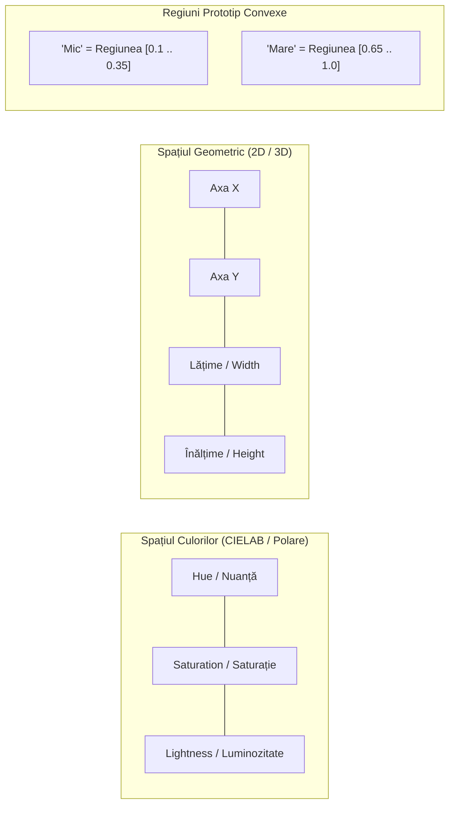

# 04. Ce ar putea fi făcut mai general: Generalizări Arhitecturale și Algoritmi Unificați

Acest document descrie arhitectura țintă și algoritmii generici care pot înlocui zecile de mii de linii de cod procedural din `psys2` și `soplang-words-lib`, transformând platforma într-un mediu cu adevărat extensibil și declarativ.

---

## 1. Compilarea Cererilor ca Satisfacere Unificată de Constrângeri (CSP pe Grafuri SOP)

### Problema Curentă
În prezent, compilatorul `request-compiler.mjs` fragmentează rezolvarea unei cereri în metode separate și impermeabile:
* `compileGrounding` rezolvă cuvintele.
* `choice-method` alege țintele.
* `capability-method` unifică argumentele uneltelor.
* `placement-method` caută coordonate pe pânză (pentru maxim o relație!).

Dacă o cerere implică simultan constrângeri de tip, culoare, capacitate și plasare spațială, această arhitectură fragmentată eșuează.

### Algoritmul Unificat (CSP / SMT în SOP Lang)
Orice cerere compusă se formulează ca o instanță unică de **Problemă de Satisfacere a Constrângerilor** (*Constraint Satisfaction Problem - CSP*):

$$\mathcal{P} = \langle \mathcal{X}, \mathcal{D}, \mathcal{C}, \mathcal{O} \rangle$$

1. **Variabilele ($\mathcal{X}$)**:
   * $T_i$: operația de unealtă aleasă pentru acțiunea $i$ (ex. `drawing.object.make` vs `drawing.object.update`).
   * $O_i$: obiectele vizate (entități existente din instanță sau identități noi).
   * $V_{i,k}$: parametrii obligatorii ai operației $T_i$ (coordonate $x, y$, mărime, culoare, text).
2. **Domeniile ($\mathcal{D}$)**:
   * Domeniul lui $T_i$: operațiile compatibile din `std.capability.operation`.
   * Domeniul lui $O_i$: obiectele active din lumea-instanță plus un generator de ID-uri noi.
   * Domeniul lui $V_{i,k}$: intervale finite (geometrie), enumerări (culori) sau referințe din cunoaștere (`k.*`).
3. **Constrângerile Hard ($\mathcal{C}$)**:
   * Reguli de tip (`core.slot kind=...`).
   * Interdicții declarate (`core.deny`), de exemplu evitarea suprapunerilor nepermise sau depășirea capacității unei mese.
4. **Funcția Obiectiv / Preferințe Soft ($\mathcal{O}$)**:
   * Punctajul total se compune din:
     $$\mathcal{O} = w_{\text{focus}} \cdot S_{\text{focus}} + w_{\text{abduce}} \cdot S_{\text{abduce}} + w_{\text{gap}} \cdot S_{\text{gap}} - \text{Penalizări}$$
   * Preferă obiectele din focus, interpretările lexicale cu cost minim de abducție și distanțele ergonomice de plasare.

### Conectarea la Solverul CDCL Existent
Biblioteca `soplang-words-lib` are deja implementat în `src/solve.mjs` un solver complet bazat pe **Conflict-Driven Clause Learning (CDCL)** (`Problem`, `cdcl()`, `nogoods`).
* În loc să folosim bucle ad-hoc în `placement-method` și `capability-method`, variabilele cererii sunt compilate direct într-o instanță de `Problem`.
* Solverul CDCL explorează spațiul de stări, propagă valorile determinate prin unificare și returnează prima soluție optimă verificată de matricea de consistență.

---

## 2. Spații Conceptuale Multidimensionale (Modelul Gärdenfors)

### De ce este Necesar?
Astăzi, conceptele de grad („mic”, „mare”, „în stânga sus”, „lung”, „aproape”) sunt hardcodate în tabele JavaScript din editoare sau tratate ca simple string-uri.

### Modelul Teoretic (Gärdenfors, *Conceptual Spaces*)
Conceptele nu sunt simboluri discrete, ci **varietăți metrice convexe** definite peste dimensiuni de calitate:



### Clase de Comparație Declarative
Mărimea este întotdeauna relativă la **clasa de comparație**:
* Când cererea spune „o casă mică”, sistemul citește mărimea tipică a unei case din `k.objects.house` (ex. medie = 150px, deviație = 30px). Regiunea „mic” devine $[90\text{px} .. 120\text{px}]$.
* Când cererea spune „un pește mic”, clasa de comparație este `k.objects.fish` (ex. medie = 30px). Regiunea „mic” devine $[15\text{px} .. 22\text{px}]$.
* **Rezultat**: Niciun `if` în JavaScript! Raportarea la scară este o operație matematică generică efectuată de bibliotecă pe baza distribuțiilor declarate în ontologie.

---

## 3. Ancorarea Lexicală prin Abducție Ponderată (*Weighted Abduction*)

### Viziunea
Înlocuirea tuturor verificărilor separate din aplicație (corectură ortografică, lematizator, sinonimie, derivare ontologică) cu un singur algoritm de **Abducție Ponderată**:

Fiecare relație de derivare a unui termen are un cost declarat în cunoaștere:
* **Identitate exactă**: cost $0$ (ex. `tree` $\rightarrow$ `tree`).
* **Formă flexională (plural / feminin)**: cost $1$ (ex. `trees` $\rightarrow$ `tree`).
* **Sinonimie directă (`core.word`)**: cost $1$ (ex. `cottage` $\rightarrow$ `house`).
* **Sub-tip / Hiponimie în ontologie**: cost $2$ (ex. `man` $\rightarrow$ `person`).
* **Corecție ortografică (Damerau-Levenshtein)**: cost $2 \times \text{distanță}$.

### Eliminarea Arbitrariului
* Când utilizatorul tastează „man”:
  * Candidatul *person* are costul $2$ (relație ontologică).
  * Candidatul ortografic *moon* are costul $2 \times 2 = 4$.
  * Candidatul *person* câștigă detașat prin costul minim, fără ca sistemul să elimine candidați prin limite oarbe de genul `cost <= 2`!
* În cazul unei egalități reale (ex. „cap” $\rightarrow$ *cat* [cost 2] vs *car* [cost 2]), sistemul:
  1. Verifică contextul instanței (există deja o pisică sau o mașină pe pânză?).
  2. Dacă egalitatea persistă, execută cea mai plauzibilă variantă și păstrează alternativa în jurnal:
     > *„Am desenat o pisică. Dacă doreai o mașină, spune 'nu, mașină'.”*

---

## 4. Planificare Ierarhică (HTN) cu I/O Tipizat între Unelte

### Soluția pentru Scenariul Multi-Editor
Pentru a realiza compunerea automată de tip:
$$\text{Calendar} \longrightarrow \text{Chart} \longrightarrow \text{Document}$$

Fiecare uneltă își declară interfețele native cu tipuri de date SOP:
```
@calendar.query.events core.type of=std.capability.operation
  requires=time.range
  returns=std.collection.events

@diagram.chart.create core.type of=std.capability.operation
  requires=std.collection.datapoints
  returns=diagram.chart.handle

@document.insert.image core.type of=std.capability.operation
  requires=diagram.chart.handle
```

### Compunere Automată prin Unificare de Tipuri
1. Planificatorul HTN (`plan.mjs`) primește scopul de nivel înalt:
   `@goal std.goal name="weekly_report_summary"`
2. Consultă `k.procedures` și găsește pașii:
   * Pasul 1: `calendar.query.events` (produce `$events`).
   * Pasul 2: Adaptor de tip `std.convert of=$events to=std.collection.datapoints` (agregare evenimente pe zile).
   * Pasul 3: `diagram.chart.create` (produce `$chart`).
   * Pasul 4: `document.insert.image` (inserează `$chart` în documentul deschis).
3. Circuitul compilat este trimis ca o singură tranzacție atomică. Dacă un pas eșuează, întregul grup este anulat prin Undo.

---

## 5. Unificarea Ontologiei și Verificarea Statică a Contractelor

### Reconcilierea Namespace-urilor
În prezent, tipurile sunt fragmentate între `k.*` (fapte de cunoaștere), `w.*` (scheme) și `app.*` (declarații interne din psys2).
* **Soluție**: Crearea unei ierarhii clare de namespace-uri cu moștenire explicită:
  * `core.*`: primitivele limbajului SOP Lang.
  * `std.*`: mecanismele generale ale bibliotecii (cereri, capabilități, spații, alegeri).
  * `ont.*`: ontologia generală de concepte (obiecte, forme, culori, unități).
  * `host.*`: contractele specifice aplicațiilor și uneltelor.
* **Verificare Statică (Linter & Type Checker)**:
  * Orice fir ce folosește `to=`, `of=`, `by=` este validat static la build.
  * Nu se mai acceptă referințe deschise sau join-uri nerezolvate în cataloagele publicate.
