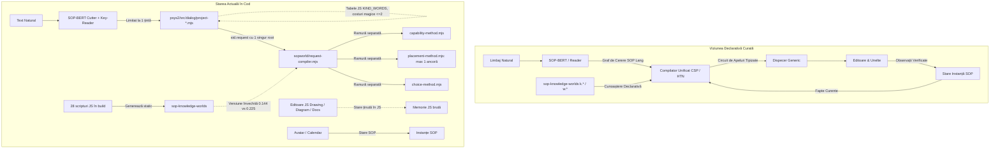

# Review Strategic și Arhitectural: Ecosistemul SOP Worlds
**Proiecte analizate**: `soplang-words-lib` (motor), `sop-knowledge-worlds` (ontologie & cunoaștere), `psys2` (aplicație & asistent)  
**Data analizei**: Noiembrie 2026  
**Autor**: Review Agent (Antigravity)

---

## 1. Context și Viziune

Cele trei proiecte formează un ecosistem ambițios menit să implementeze un asistent determinist de tip **System 2** ce rulează complet în browser (sau Node.js), fără un LLM în bucla de decizie:

1. **`soplang-words-lib`** (`sopworld`): Motorul de calcul și inferență semantică bazat pe matrici de consistență (*consistency matrices*), reguli logice (`core.rule`), constrângeri de interdicție (`core.deny`), deducție, abducție, inducție și compilare de cereri.
2. **`sop-knowledge-worlds`**: Depozitul ontologic și de cunoaștere statică/reutilizabilă (`k.*` pentru fapte de bun-simț, relații, vocabular, spațiu, acțiuni; `w.*` pentru scheme de lumi reutilizabile).
3. **`psys2`** (PragmaticSystem2): Aplicația gazdă (editoare pentru Drawing, Diagram/Charts, Documents, Calendar, Avatar). Integrează modele neuronale compacte (SOP-BERT: cutter și key-reader) pentru transformarea limbajului natural în fire SOP Lang, compilați prin `sopworld` în comenzi directe de unelte.

### Teza Centrală
> **„Rețelele neuronale citesc, lumile SOP decid.”**  
> Niciun LLM nu dictează acțiuni. Rețeaua neuronală extrage intenția și rolurile sub formă de graf de fire SOP Lang (`std.request.*`), iar biblioteca generică compilează aceste fire raportându-se la cunoaștere (`k.*`), schemă (`w.*`) și starea instanței curente, producând apeluri de unelte tipizate și verificate.

---

## 2. Diagrama Arhitecturală: Ideal vs Realitate

---

## 3. Sinteza Rapoartelor din `agy-review/`

Acest folder conține o analiză tehnică exhaustivă, organizată în 4 documente fundamentale:

### [01. Ce este greșit în abordare](./01-ce-este-gresit-in-abordare.md)
* **Scurgerea semanticii în JavaScript (Leaky Abstraction)**: În loc ca deciziile să fie luate declarativ în SOP, fișierele din `psys2` (`project-query-action.mjs:104`, `project-create-action.mjs`, `art.draw/engine.mjs`) conțin tabele hardcodate (`KIND_WORDS`), regexuri pentru concepte („water|sea|ocean”), decupaje arbitrare de distanță Levenshtein (`<= 2`) și rezolvarea egalităților prin ordinea de enumerare din memorie.
* **Capcana „Single-Root”**: `request-compiler.mjs:40` impune rigid `if (roots.length !== 1 || contexts.length > 1) return fail('request-root')`, făcând imposibilă compilarea nativă a cererilor coordonate sau a acțiunilor compuse („desenează un copac și o casă”).
* **Silozuri de compilare în loc de CSP unificat**: În loc de un motor unificat de satisfacere a constrângerilor, compilatorul bifurcă în algoritmi izolați (`placementCircuit`, `compileCapabilityCircuit`, `compileChoice`), unde de exemplu plasarea suportă doar o singură relație (`relation = one(...)`).
* **Pseudo-declarativism în generarea cunoașterii**: În `sop-knowledge-worlds`, cunoașterea nu este dedusă prin reguli SOP la încărcare, ci este generată mecanic prin 28 de scripturi Node.js înlănțuite în `package.json`.
* **Monolitul distribuit și iadul vendoring-ului**: `sopworld.mjs` este un fișier mamut de 1.7 MB (24.000+ rânduri, 275 exporturi din care aplicația folosește ~20), copiat manual între depozite. Versiunile au divergente masive: `sop-knowledge-worlds` este blocat la `0.144.0` (commit `94cffa2e`), în timp ce `psys2` și biblioteca sunt la `0.225.1`.

### [02. Ce este incomplet](./02-ce-este-incomplet.md)
* **Starea instanțelor este fracturată în două**: Doar Calendar și Avatar au fost migrate pe instanțe SOP. Drawing, Diagram și Documents își țin încă starea în obiecte JS brute (`ctx.state`), creând o ruptură totală în mecanismul de Undo, serializare și deducție.
* **SOP-BERT gâtuit la o singură cerere și o singură țintă**: Modelul curent nu poate produce mai multe ținte sub același act și nu poate extrage ancore relaționale multiple fără a le strivi într-o singură etichetă.
* **Absența planificării HTN și a fluxului de date cross-unelte**: Scenariul de referință „Calendar → Grupare → Grafic → Document” nu poate fi executat deoarece lipsește legarea automată a ieșirilor tipizate ale unei unelte la intrările altei unelte.
* **Planificator deconectat**: `src/plan.mjs` (bazat pe `k.procedures`) este un modul sofisticat, dar `psys2` nu îl folosește, preferând o serie de interpretoare ad-hoc (`declared-dispatch.mjs`, `spatial-placement-execution.mjs`, `native-query-execution.mjs`).
* **Referințe pe mulțimi și cuantificatori neimplementate**: Suport doar pentru referințe singulare („it”, „the other one”). Nu există rezolvare semantică pentru „toate”, „ambele”, „a doua casă”, „cea de lângă lac”.
* **Cod zombie și reziduuri istorice**: În `psys2` există încă `src/formalizer` (5.700 linii), `src/translate` (8.500 linii), precum și vechile modele dispecer/normalizator care nu mai sunt utilizate dar încarcă baza de cod.

### [03. Ce ar putea fi făcut mai bine](./03-ce-ar-putea-fi-facut-mai-bine.md)
* **Trecerea la Monorepo (pnpm / npm workspaces)**: Eliminarea copierii de fișiere `sopworld.mjs` de 1.7MB. Împărțirea în pachete modulare `@sopworld/core`, `@sopworld/compiler`, `@sopworld/solver`, `@sopworld/catalog`.
* **Optimizarea catalogului de cunoaștere și a consumului de memorie**: `sop-knowledge-worlds` necesită minim 3GB RAM pentru `sync.sh` și parsează repetat fișiere `.sop` gigantice (`vocab-kinds.json` de 4.9MB). Trecerea la un index binar (sau SQLite / IndexedDB în browser) cu încărcare leneșă reală.
* **Explicabilitate semantică de prim rang (First-Class Tracing)**: Înlocuirea erorilor opace de tipul `status=unavailable reason=no-method` cu arbori de decizie structurați care expun criteriile de eșec și permit dialogul de dezambiguizare cu utilizatorul.
* **Pipeline de evaluare continuă cap-coadă (Golden Suite)**: Înlocuirea testelor de unitate mockate cu o suită independentă de 300+ interacțiuni reale executate de la text la efectul confirmat în DOM / Canvas.
* **Eliminarea alocărilor masive (`World.fork`)**: În buclele de căutare și plasare, `world.fork()` este apelat de sute de ori, cauzând presiune imensă pe Garbage Collector.

### [04. Ce ar putea fi făcut mai general](./04-ce-ar-putea-fi-facut-mai-general.md)
* **Compilarea cererilor ca Satisfacere de Constrângeri Unificată (CSP / SMT pe grafuri SOP)**: Unificarea metodelor disparate de plasare, alegere și capabilitate sub motorul CDCL existent în `solve.mjs`. Orice parametru lipsă este o variabilă de domeniu finit; orice regulă este un propagator sau un nogood.
* **Spații Conceptuale Multidimensionale (Modelul Gärdenfors)**: Implementarea completă a teoriei din Capitolul 4 al cărții. Culoarea, mărimea, forma, spațiul și timpul definite ca varietăți metrice cu regiuni prototip convexe, interpretate relativ la clasa de comparație („casă mică” vs „furnică mică”).
* **Ancorare Lexicală prin Abducție Ponderată (*Weighted Abduction*)**: Unificarea lematizării, ortografiei, sinonimiei și taxonomiei într-un singur algoritm bazat pe costuri de penalizare declarate în SOP, păstrând ipotezele alternative active pe parcursul dialogului.
* **Planificare Ierarhică (HTN) cu flux de date tipizat**: Uneltele declarate ca operatori cu precondiții și postcondiții tipizate, permițând compunerea automată de lanțuri de acțiuni complexe cu un singur pas de Undo.
* **Sistem Unificat de Tipuri și Contracte Ontologice**: Reconcilierea namespace-urilor `k.*`, `w.*` și `app.*` sub o verificare statică strictă de tipuri și integritate referențială la build.

---

## 4. Top 10 Concluzii și Decizii Imediate

| # | Concluzie / Problemă | Rădăcină | Acțiune Recomandată |
|---|---|---|---|
| **1** | **Semantica încă trăiește în JS** | `psys2` rezolvă cuvinte și scenă prin `KIND_WORDS`, cost Levenshtein fix (`<=2`) și tabele ad-hoc. | Mutarea oricărei decizii semantice în politici SOP de abducție ponderată și în `k.objects`/`k.scenes`. |
| **2** | **Compilatorul refuză cereri multiple** | `request-compiler.mjs:40` forțează `roots.length === 1`. | Suport pentru cereri compuse (pădure de arbori / sub-cereri coordonate). |
| **3** | **Plasarea e rigidă (1 relație, 1 ancoră)** | `placement-method.mjs` extrage `relation = one(...)`. | Trecerea la un solver CSP geometric capabil de constrângeri multiple simultane. |
| **4** | **Starea e schizofrenică** | Draw, Diagram, Docs sunt în JS; Avatar și Calendar sunt în SOP. | Finalizarea migrației stării instanțelor Drawing, Diagram și Docs pe fire SOP. |
| **5** | **SOP-BERT e decuplat de coordonare** | Modelele de extracție extrag doar o singură țintă per cerere. | Antrenarea cutter-ului pe span-uri multiple și emiterea de relații n-are. |
| **6** | **Iadul de vendoring și versiuni** | Copiere de fișier 1.7MB; `sop-knowledge-worlds` folosește `sopworld` v0.144, `psys2` folosește v0.225. | Monorepo cu workspace intern; un singur `sopworld` folosit de toți. |
| **7** | **Solverul CDCL din `solve.mjs` e nefolosit** | `placement` și `capability` au re-inventat căutări ad-hoc în JS. | Unificarea compilării cererilor ca o instanță de `Problem` în `solve.mjs`. |
| **8** | **Cunoașterea e generată prin 28 scripturi JS** | `sop-knowledge-worlds` rulează un lanț fragil de scripturi ce cer 3GB RAM. | Unificarea pipeline-ului de catalogare într-un singur proces incremental. |
| **9** | **Planificatorul HTN (`plan.mjs`) este orfan** | `psys2` execută cererile printr-un dispecer procedural propriu. | Integrarea uneltelor `std.capability` direct în operatorii HTN din `std.plan`. |
| **10**| **Mii de linii de cod mort (zombie)** | `src/formalizer`, `src/translate`, vechiul parser pe gramatică. | Ștergerea fără ezitare a componentelor depreciate pentru a debloca evoluția curată. |
