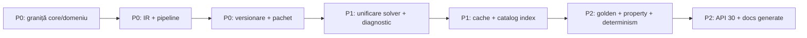

# 03. Ce ar putea fi făcut mai bine

Propunerile sunt ordonate după efectul asupra celor trei proiecte, nu după cât de mari sunt. Fiecare
are un criteriu de acceptare verificabil. Nu propun rescrierea kernelului; propun **strângerea**
lui în jurul a ceea ce face deja bine.

## P0. Îngheață un nucleu și mută domeniul în afara lui

**Problema:** `src/` cunoaște `w.legend`, `w.document`, `w.diagram`, `k.genres`, `k.scenes`,
`k.commonsense`. Biblioteca nu poate fi stabilă dacă depinde de lumile pe care ar trebui să le
încarce.

**Ce faci:**

1. Definește `src/core/` cu numai: parser, unify, matrix, world, revise, complete, solve, query,
   budget, cow, tiers, describe. Acesta este „core 1.0”.
2. Mută în pachete opționale sau în `sop-knowledge-worlds`:
   - `w.legend` (contractul și lumile),
   - `compose.mjs`, `story.mjs`, `document.mjs`, `diagram.mjs`, `realise.mjs`, `morph.mjs`,
   - `kit.mjs`, `tool.mjs`, `request.mjs` (host kit),
   - `spell.mjs`, `reader.mjs`, `frames.mjs`, `clauses.mjs` (limbaj).
3. Adaugă un test de graniță care rulează `git grep` pentru `k\.` și `w\.` în `src/core/` și eșuează
   dacă apar. Nu este un test de stil; este testul care apără arhitectura.
4. Mută `w.legend` din `src/contracts.mjs` în `sop-knowledge-worlds`, cu un test că biblioteca îl
   încarcă fără să îi cunoască numele.

**Criteriu de acceptare:** `src/core/` nu conține niciun nume de lume publicată; `npm test` trece;
`psys2` încarcă `w.legend` din catalog, nu din bundle.

**De ce primeiro:** fără asta, orice generalizare din 04 este contrazisă de un `if` în `src/`.

## P0. Un singur IR și un singur pipeline de compilare

**Problema:** `compilePacket` este un lanț de `if`-uri după tipul de wire; fiecare ramură are alt
contract și alt rezultat.

**Ce faci:**

1. Definește un IR neutru, în JSON și în SOP:
   - `nodes`: `request`, `target`, `constraint`, `value`, `action`, `result`, `evidence`;
   - `edges`: `owns`, `selects`, `binds`, `produces`, `requires`;
   - `meta`: sursă, span, versiune de contract.
2. Pipeline cu faze fixe, fiecare cu un singur tip de rezultat:
   `parse → validateContract → admit → plan → verify → emit`.
3. Fiecare fază returnează `{ ok, value?, issues[] }`, unde `issues` au `code`, `stage`, `span`,
   `candidates`, `why`.
4. Ramurile actuale devin **providere** în faza `plan`, înregistrate într-un registry, nu `if`-uri.
   Ordinea se declară în contract, nu în cod.
5. `compileRequest` returnează `Plan` (obiect), nu string. Serializarea SOP rămâne o funcție
   separată, la marginea hostului.

**Criteriu de acceptare:** o cerere cu două root-uri produce un `Plan` cu două noduri sau un
`Issue` care numește ambele root-uri; niciun apelant nu mai face `parse(compileRequest(...))`.

**Efort:** 2–3 săptămâni pentru IR + migrarea a două ramuri (rule + capability), restul incremental.

## P0. Contract de versiune între cele trei proiecte

**Problema:** `core.module version=` este o etichetă (`matrix.mjs:360`); cunoașterea este validată cu
0.144.0, biblioteca este la 0.225.1; aplicația copiază bundle-ul.

**Ce faci:**

1. Publică `soplang-words-lib` ca pachet npm real, cu `exports` per subpath și semver.
2. Fiecare modul de cunoaștere primește un manifest:
   ```json
   { "name": "k.objects", "version": "8", "requires": { "sopworld": ">=0.225 <0.226" },
     "exports": ["object", "part"], "hash": "sha256:..." }
   ```
3. `core.module version=` se compară la încărcare cu `requires`; incompatibilitatea este un refuz
   tipizat, nu un warning.
4. `index.json` are un hash de conținut per shard; `createCatalog` verifică hash-ul înainte de `tell`.
5. `psys2` nu mai are copie vendor; are o dependență cu lockfile. Build-ul de un singur fișier rămâne
   un artefact de release, nu sursa de adevăr.
6. CI matrice: `lib {N-2, N-1, N} × knowledge {M-1, M} × app {head}`.

**Criteriu de acceptare:** un catalog cu `requires` incompatibil este refuzat cu un cod stabil;
`npm ls sopworld` arată aceeași versiune în toate cele trei proiecte.

## P1. Unifică motoarele: un `World`, un solver

**Problema:** `reason.mjs`, `plan.mjs` și `request.mjs` au fiecare propria deducție și propria
simulare.

**Ce faci:**

1. `reason.mjs` devine un **view** peste `World` (deja este `factsOf`), iar `REASON_RULES` devin
   reguli `core.rule` încărcate dintr-un modul `std.reason`. `deduceState` apelează `World` pe un
   fork, nu un forward-chaining separat.
2. `plan.mjs` devine un **planner peste `World`**: `PlanLive` se șterge; pașii se aplică pe un fork,
   iar rezultatul este un `Plan` cu efecte și dovezi. `factStore` rămâne doar un adaptor de citire
   pentru cunoaștere.
3. `placement`, `choice`, `grounding` se exprimă ca `Problem` din `solve.mjs`:
   - variabile = câmpurile libere ale țintelor;
   - domenii = valorile admise de contract;
   - nogoods = constrângerile hard;
   - cost = criteriile `std.decide`.
4. Elimină exporturile duplicate: `planner` și `planRequest` nu pot fi amândouă publice fără o
   declarație clară de deprecare.

**Criteriu de acceptare:** același scenariu de plasare/alegere produce același rezultat prin ambele
căi dispărute; `solve.mjs` este folosit de compilatorul de cereri, nu doar de `complete`.

**De ce:** `Problem` există deja, este testat și are oracle. Este cea mai ieftină generalizare din tot
proiectul.

## P1. Diagnostic structurat și trasabilitate

**Problema:** `fail('request-root')` nu spune nimic utilizatorului sau dezvoltatorului.

**Ce faci:**

1. Un tip `Issue`:
   ```js
   { code: 'request.root.multiple', stage: 'validate', severity: 'error',
     span: { start, end }, nodes: ['r1', 'r2'],
     candidates: [{ id, why }], fix: 'split-request' }
   ```
2. Codurile sunt versionate și documentate într-un tabel generat; testele verifică codul, nu stringul.
3. Fiecare fază adaugă `issues`, nu aruncă și nu întoarce string.
4. `explain` pentru compilare: lanțul de decizii, nu doar rezultatul.
5. Păstrează `std.compile.evidence` pentru compatibilitate, dar derivă-l din `Issue`/`Plan`.

**Criteriu de acceptare:** un refuz de compilare poate fi afișat în UI fără cod specific și poate fi
reprodus dintr-un test cu exact aceleași `issues`.

## P1. Cache și snapshot consistent

**Problema:** fiecare cerere reface parse, fork, admitere, căutare; knowledge projection este async
fără snapshot.

**Ce faci:**

1. Cache de compilare cu cheia `(world.stamp, hash(sop), catalog.version, contract.version)`.
2. Invalidează la `world.stamp` și la schimbarea catalogului; nu cache-ui niciodată un rezultat
   `unavailable` fără motiv stabil.
3. Pentru knowledge projection, capturează un `snapshot` al lumii înainte de `await` și verifică
   `stamp` la întoarcere; dacă s-a schimbat, reia sau refuză cu `source-changed`.
4. Index de catalog pe shard-uri: un fișier mic per literă/prefix, nu `vocab.json` monolit. Încarcă
   doar intrarea necesară.
5. Compresie (brotli/gzip) și hash per shard; măsoară bytes descărcați în testul de browser.

**Criteriu de acceptare:** a doua cerere identică nu mai parsează și nu mai face fork; cold start
pentru un cuvânt descarcă < 200 kB; testul de browser măsoară și afișează bytes.

## P2. Testare: contract, golden, property, determinism

**Ce faci:**

1. **Contract suite** comună: aceleași fișiere de cazuri rulate pe bibliotecă, cunoaștere și aplicație.
2. **Golden corpus**: 100–300 de interacțiuni reale, fiecare cu text, cerere, plan, apel, efect,
   răspuns. Se acceptă doar dacă toate cele trei proiecte sunt la versiunile declarate.
3. **Property-based** pentru parser/serializer/unify: round-trip, idempotență, `parse(serialize(x))`
   egal cu `x` pentru orice wire valid; fuzz pe text.
4. **Determinism**: rulează suita cu `TZ=UTC` și `TZ=Pacific/Kiritimati`, `LANG=en_US` și `tr_TR`;
   interzice `localeCompare` în codul de decizie (sau impune un comparator explicit).
5. **Refuz stabil**: fiecare cod de motiv are un test care îl fixează; schimbarea lui este breaking.

**Criteriu de acceptare:** un PR care schimbă semantica de refuz sau de ordine pică cel puțin un test
cross-proiect, nu doar un test local.

## P2. Performanță și memorie

**Ce faci:**

1. Benchmark-uri în CI pentru: `compileRequest` pe 100 de cereri, `fork` pe o lume de 10k fire,
   `createCatalog.into` pentru un cuvânt, `World.tell` pe un shard.
2. Bugete explicite pe browser: timp și memorie; eșec dacă depășește.
3. Elimină parse-ul dublu: `compileRequest` parsează, apoi `world.tell` parsează din nou wire-urile
   deja parsate. Acceptă un `Wire[]` în API-ul intern.
4. Măsoară `fork` în buclele de căutare; dacă este dominant, folosește `Problem` cu push/pop, nu fork
   per candidat.

**Criteriu de acceptare:** `npm run bench` raportează aceleași valori în CI cu toleranță; nicio
regresie > 20% fără justificare în PR.

## P2. API și documentație

**Ce faci:**

1. Redu suprafața publică la ~30–40 de nume. Restul devine intern sau subpath explicit
   (`sopworld/reader`, `sopworld/compose`).
2. Un singur loc pentru adevăr: `src/index.mjs` + `index.d.ts` generate din el, nu editate manual.
3. Tabelul de capabilități generat din teste/contracte, nu dintr-un markdown paralel.
4. Pagină de deprecare cu fiecare export scos și înlocuitorul lui.
5. `CHANGELOG` pe teme (core, knowledge, host) și cu secțiune „breaking” obligatorie.

**Criteriu de acceptare:** `index.d.ts` nu poate divergea de `index.mjs` fără ca testul de generare să
pice; fiecare export public are un test și o intrare în docs.

## Ce nu aș face

- Nu aș rescrie `World` sau `solve.mjs`. Sunt partea bună.
- Nu aș adăuga încă un tip de wire pentru fiecare cerere nouă. Asta este simptomul, nu soluția.
- Nu aș muta totul în cunoaștere. Mecanismele generale rămân în bibliotecă; doar cunoașterea și
  schemele de domeniu pleacă.
- Nu aș optimiza prematur `fork` înainte de a avea benchmark-ul din P2.
- Nu aș face un „LLM în buclă” ca soluție la acoperire. Problema este contractul, nu modelul.

## Ordinea recomandată



Primele trei sunt blocante: fără ele, restul reface aceleași compromisuri. Ultimele trei se pot face
în paralel, pe măsură ce echipele migrează ramurile.
