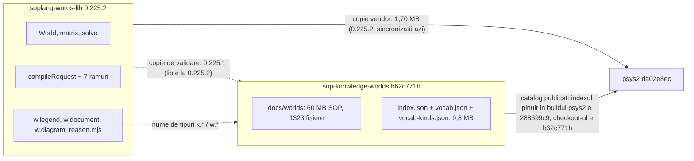

# Review independent: ecosistemul SOP Worlds

**Proiecte:** `soplang-words-lib` (motorul), `sop-knowledge-worlds` (cunoaștere), `psys2` (aplicația).
**Commituri citite:** `soplang-words-lib` `ac33216` (0.225.2), `sop-knowledge-worlds` `b62c771b` (validează cu sopworld 0.225.1), `psys2` `da02e8ec`.
**Data:** 19 noiembrie 2026.
**Autor:** review independent (Mistral), pe cod, teste și manifeste, nu pe prezentări.

## Două citiri în aceeași zi

Prima ediție a fost scrisă la `soplang-words-lib` `747b51e` (0.225.1). Spre seară, codul citit se
schimbase: biblioteca a trecut la 0.225.2, catalogul de cunoaștere a fost revalidat cu buildul
curent (`b62c771b`), iar psys2 a mutat tabul Avatar pe o arie SOP generică (`da02e8ec`). Această
ediție re-verifică fiecare afirmație contra `ac33216` și corectează numerele greșite din prima ediție;
concluziile care rezistă re-verificării rămân; ce s-a schimbat este marcut cu „schimbat de la citirea I”.

Acest folder nu repetă `agy-review/`. Acolo accentul este pe funcțiile lipsă din aplicație
(plasare relativă, cereri compuse, stare în JS). Aici accentul este pe **contractul dintre cele trei
proiecte** și pe **forma mecanismelor**: unde abordarea nu poate crește, unde se contrazice singură
și ce ar trebui generalizat înainte de a adăuga încă o capacitate.

## Verdict

Kernelul este bun: tranzacții, copy-on-write, explicații, solver CDCL, teste multe și serioase.
Problema nu este miezul. Problema este că **deasupra kernelului s-au construit trei motoare paralele
și un compilator cu ramuri speciale**, iar cele trei proiecte sunt legate prin copiere de fișiere și
prin convenții, nu printr-un contract mașin-verificat — legătura e ținută de oameni și de obiceiuri.

Pe scurt:

1. `compileRequest` este un **router de cazuri speciale**, nu un compilator: alege ramura după tipul
   de wire prezent și refuză orice cerere cu mai mult de un root. Neschimbat.
2. Există **cel puțin trei modele de execuție** pentru aceleași noțiuni: `World` + reguli,
   `reason.mjs` (view plat + `REASON_RULES`), `plan.mjs` (`PlanLive` + fact store). Neschimbat.
3. Granița „bibliotecă = mecanisme, cunoaștere = date” este **încă încălcată în `src/`**: `w.legend`,
   `w.document`, `w.diagram`, `k.commonsense`, `k.scenes`, `k.kinds`, `k.genres`, `k.interest`.
   Neschimbat.
4. Rezultatele compilării sunt **text SOP**, nu obiecte: `status=unavailable reason=...`, uneori
   string gol; apelantul re-parsează și pierde candidatul, etapa și span-ul. Neschimbat.
5. Nu există **contract de versiune** între proiecte: `core.module version=` este doar o etichetă.
   **Schimbat de la citirea I:** decalajul „catalogul s-a validat cu 0.144.0” a fost închis chiar în
   ziua în care a fost semnalat (catalogul validează acum cu 0.225.1), dar prin aceeași copie de mână —
   până seara biblioteca este la 0.225.2 și copia este din nou în urmă. O zi întreagă a durat
   realinierea; mecanismul care a produs decalajul nu s-a schimbat.
6. Un singur fișier de 1,70 MB și **277 de exporturi** pentru un consumator care folosește 15.
   Neschimbat.
7. Metoda de lucru — o capacitate nouă la fiecare versiune, 216 versiuni, 48 de rânduri în tabelul
   de capabilități — a produs **suprafață**, nu **stabilitate**. Neschimbat.

## Cum arată dependențele azi

Săgețile punctate sunt problema reală: biblioteca **cunoaște** numele unor lumi pe care ar trebui doar
să le încarce, iar cele trei proiecte țin builduri diferite la versiuni diferite — azi, în interiorul
unuia singur commit al psys2, există trei referințe la versiuni diferite ale ecosistemului:
vendor `sopworld.mjs` la 0.225.2, `new-engine-source.mjs` cu `libraryPin 747b51e` + `knowledgePin
288699c9`, iar checkout-ul de cunoaștere local la `b62c771b`. Nici o mașină nu compară aceste
valori între ele.

## Dovezi măsurate (citirea a II-a, `ac33216`)

| Măsură | Valoare | Sursă |
| --- | --- | --- |
| Module în `src/` | 108 direct în `src/` + 2 în `internal/` = 110 | `find src -name '*.mjs'` |
| Build single-file | 1.663,2 kB, 466,3 kB gzip, 109 module, 24.860 linii | `docs/version.md`, `wc -l docs/sopworld.mjs` |
| Exporturi publice | 277 | `import * as m from './src/index.mjs'` |
| Exporturi folosite de `psys2` | 15 | nume distincte din importurile `../vendor/sopworld/sopworld.mjs` |
| Versiuni în changelog | 216 secțiuni, 2.928 de linii | `grep -c '^## ' CHANGELOG.md` |
| Capabilități | 51 secțiuni în `docs/capabilities.md`, 48 de rânduri în tabelul din README | `grep -c '^## '`, `awk` |
| Teste bibliotecă (surse) | 1025: 1023 pass, 0 fail, 1 skip, 1 todo | `npm test` (include `tools/build.mjs`) |
| Teste bibliotecă (bundle) | 1025: 1023 pass, 0 fail, 1 skip, 1 todo | `SOPWORLD_BUNDLE=1 node --test "test/**/*.test.mjs"` |
| Teste cunoaștere | 3267: 3249 pass, 0 fail, 18 skip | `npm test` în catalog (două rulări identice; o rulare concomitentă cu buildul bibliotecii a arătat 2 eșecuri tranzitorii, nereproductibile) |
| Teste aplicație (rulare locală) | 626: 617 pass, 6 fail, 3 skip, după `build:webchat` | `npm test` în psys2, pe checkout cu paralel-lucru nesalvat |
| Cunoaștere publicată | 60,1 MB SOP (57,3 MiB), 1323 fișiere | `du -cb docs/worlds/**/*.sop` |
| Index + vocabular | 1,73 + 3,37 + 4,70 MiB JSON | `ls -la docs/worlds/*.json` |
| Versiune validare cunoaștere vs bibliotecă | 0.225.1 (build `8a63e3e83fef`, commit `747b51e`) vs 0.225.2 | `tools/sopworld/VERSION`, `package.json` |
| Pinuri vs checkout-uri | `repos.pin`: cunoaștere `a0e8538` / aplicație `45ac4bf`; checkout-uri: `b62c771b` / `da02e8ec` | `repos.pin`, `git rev-parse` |
| Taguri git | 0 în bibliotecă, 0 în cunoaștere, 1 în aplicație (`pre-tab-cut`) | `git tag` |

Eșecurile din `psys2` la citirea a II-a sunt în testele buildului generat și ale arhivelor (worker
de browser, arhive byte-exacte, undo pe sesiune, garda Document/Calendar, pin vechi de cunoaștere,
RPC Worlds). Prima ediție raporta „3 eșecuri în exportul SOP-BERT”; acel set nu se mai reproduce
astăzi. Le menționez pentru că arată ce înseamnă „gate verde” când gate-ul este local și depinde de
ce checkout-uri și ce build-uri ai; nu le folosesc ca dovadă pentru critica de arhitectură.

## Top 10 constatări

| # | Constatare | Severitate | Unde se vede |
| --- | --- | --- | --- |
| 1 | Compilatorul este un lanț de ramuri după tipul de wire, cu un singur root | P0 | `src/request-compiler.mjs:20-33,40` |
| 2 | Trei motoare pentru aceleași noțiuni: `World`, `reason.mjs`, `plan.mjs` | P0 | `src/reason.mjs:30-49`, `src/plan.mjs:71`, `src/request.mjs:1595`, `src/tool.mjs:284`, `src/index.mjs:50,70,74` |
| 3 | Domeniul a intrat în bibliotecă: `w.legend`, `w.document`, `w.diagram`, `k.*` | P0 | `src/contracts.mjs:240`, `src/document.mjs`, `src/diagram.mjs`, `src/reason.mjs:30`, `src/compose.mjs` |
| 4 | Contracte „stringly typed”: rezultat SOP, string gol, sync/async amestecat | P0 | `src/request-compiler.mjs:11,14-16`, `src/knowledge-projection.mjs:78` |
| 5 | Fără contract de versiune între cele trei proiecte; copii de mână deja nealiniate | P0 | `src/matrix.mjs:360`, `repos.pin`, `tools/sopworld/VERSION`, `psys2/src/dialog/new-engine-source.mjs` |
| 6 | Monolit de 1,70 MB / 24.860 linii și 277 exporturi; aplicația folosește 15 | P1 | `docs/version.md`, `src/index.mjs` |
| 7 | Metoda „o capacitate pe versiune” produce API, nu un nucleu stabil | P1 | `CHANGELOG.md` (216 secțiuni), `README.md` |
| 8 | Cereri compuse și flux de date între unelte lipsesc la nivel de IR | P1 | `src/request-batch.mjs:8-31`, `docs/reference.md` (`prepareRequestBatch`) |
| 9 | Plasarea și alegerea au constrângeri hardcodate (2 ținte, 1 relație, 1 target) | P1 | `src/placement-method.mjs:52-64`, `src/capability-method.mjs:104-105` |
| 10 | Determinismul promis este subminat de `localeCompare`, `toLowerCase`, fus orar | P2 | 15 + 171 + 14 apeluri în `src/` |

Corecturi față de citirea I (metodă de numărare, nu fenomen): `toLowerCase` este **171** (nu 153) și
`Date.now`/`new Date` **14** (nu 13) — numărate identic la `747b51e` și la `ac33216`; changelogul
are **2.928** de linii (nu „~740”); testele de cunoaștere trec azi **3249/18 skip** (nu 3237/30),
pentru că revalidarea cu buildul curent a deblocat skip-uri; SOP publicat **1323** fișiere (nu 1321).

## Ce este bun și trebuie păstrat

- Kernelul `World` are semantică clară: tell all-or-nothing, jurnal, rollback, fork copy-on-write,
  `explain`, `why`, `stamp` pentru cache. Nu se rescrie.
- `solve.mjs` are un `Problem` neutru, solver CDCL și verificare prin oracle. Este exact abstractizarea
  care lipsește compilatorului de cereri.
- Testele sunt numeroase și verifică afirmații din documentație; `docs/` este generat și are exemple
  rulate. Disciplina aceasta este un activ real.
- Cunoașterea este separată fizic în alt repo, cu surse, licențe și shard-uri. Ideea este corectă;
  îi lipsește contractul.
- `psys2` are teste de browser și observații de execuție reale. Puține proiecte ajung acolo.
- Reacția la review este rapidă și țintită: validarea catalogului s-a realiniat în aceeași zi,
  Avatar a migrat pe mecanismul general, lexical admission din bibliotecă (`std.ground`) a înlocuit
  plafoanele hardcodate din adaptor. Când criticile greșesc, se corectază; asta e semn bun.

## Cum se citește restul

| Fișier | Întrebarea |
| --- | --- |
| [01-ce-este-gresit-in-abordare.md](./01-ce-este-gresit-in-abordare.md) | Ce este greșit în abordare, cu dovezi în cod |
| [02-ce-este-incomplet.md](./02-ce-este-incomplet.md) | Ce lipsește și ce este declarat „open” fără să fie rezolvat |
| [03-ce-ar-putea-fi-facut-mai-bine.md](./03-ce-ar-putea-fi-facut-mai-bine.md) | Ce aș schimba concret, în ordine, cu criterii de acceptare |
| [04-ce-ar-putea-fi-facut-mai-general.md](./04-ce-ar-putea-fi-facut-mai-general.md) | Ce mecanisme generale ar înlocui cazurile speciale |

## Limitele review-ului

- Nu am profilat memorie/CPU în browser; cifrele de timp citate sunt din teste și din
  `current-status.md`, nu din măsurători proprii.
- Nu am făcut audit de securitate; am notat doar granițele de încredere care lipsesc.
- Numerele pentru psys2 provin din checkout-ul comun de lucru; în el exista și lucrare nesalvată
  paralelă (migrarea Calendar pe `w.meetings`), deci ele descriu starea de facto a spațiului de
  lucru, nu un artefact publicat curat.
- Nu am rescris cod. Toate propunerile sunt proiectate să păstreze kernelul și testele existente.
