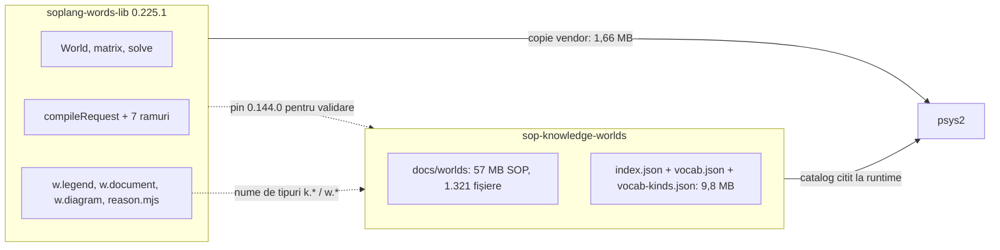

# Review independent: ecosistemul SOP Worlds

**Proiecte:** `soplang-words-lib` (motorul), `sop-knowledge-worlds` (cunoaștere), `psys2` (aplicația).
**Commituri citite:** `soplang-words-lib` `747b51e` (0.225.1), `sop-knowledge-worlds` `288699c9`, `psys2` `435b1eb6`.
**Data:** 19 noiembrie 2026.
**Autor:** review independent (Mistral), pe cod, teste și manifeste, nu pe prezentări.

Acest folder nu repetă `agy-review/`. Acolo accentul este pe funcțiile lipsă din aplicație
(plasare relativă, cereri compuse, stare în JS). Aici accentul este pe **contractul dintre cele trei
proiecte** și pe **forma mecanismelor**: unde abordarea nu poate crește, unde se contrazice singură
și ce ar trebui generalizat înainte de a adăuga încă o capacitate.

## Verdict

Kernelul este bun: tranzacții, copy-on-write, explicații, solver CDCL, teste multe și serioase.
Problema nu este miezul. Problema este că **deasupra kernelului s-au construit trei motoare paralele
și un compilator cu ramuri speciale**, iar cele trei proiecte sunt legate prin copiere de fișiere și
prin convenții, nu printr-un contract versionat. Se poate continua așa, dar fiecare capacitate nouă
va costa din ce în ce mai mult și va adânci divergența dintre aplicație, cunoaștere și bibliotecă.

Pe scurt:

1. `compileRequest` este un **router de cazuri speciale**, nu un compilator: alege ramura după tipul
   de wire prezent și refuză orice cerere cu mai mult de un root.
2. Există **cel puțin trei modele de execuție** pentru aceleași noțiuni: `World` + reguli,
   `reason.mjs` (view plat + `REASON_RULES`), `plan.mjs` (`PlanLive` + `factStore`).
3. Granița „bibliotecă = mecanisme, cunoaștere = date” este **încălcată în `src/`**: `w.legend`,
   `w.document`, `w.diagram`, `k.commonsense`, `k.scenes`, `k.kinds`, `k.genres`, `k.interest`.
4. Rezultatele compilării sunt **text SOP**, nu obiecte: `status=unavailable reason=...`, uneori
   string gol; apelantul re-parsează și pierde candidatul, etapa și span-ul.
5. Nu există **contract de versiune** între proiecte: `core.module version=` este doar o etichetă,
   cunoașterea este validată cu 0.144.0, biblioteca este la 0.225.1, aplicația are o copie de 1,7 MB.
6. Un singur fișier de 1,66 MB și **277 de exporturi** pentru un consumator care folosește 15.
7. Metoda de lucru — o capacitate nouă la fiecare versiune, 215 versiuni, 50 de rânduri în tabelul
   de capabilități — a produs **suprafață**, nu **stabilitate**.

## Cum arată dependențele azi

Săgeata punctată este problema: biblioteca **cunoaște** numele unor lumi pe care ar trebui doar să le
încarce. Săgeata groasă este a doua problemă: aplicația nu depinde de un pachet, ci de un fișier copiat.

## Dovezi măsurate

| Măsură | Valoare | Sursă |
| --- | --- | --- |
| Module în `src/` | 108 de nivel superior (110 cu `internal/`), ~1,6 MB | `find src -name '*.mjs'` |
| Build single-file | 1,66 MB, 466 kB gzip | `docs/version.md` |
| Exporturi publice | 277 | `import * as m from './src/index.mjs'` |
| Exporturi folosite de `psys2` | 15 | `grep` pe importurile din `psys2/src` |
| Versiuni în changelog | 215 | `grep -c '^## ' CHANGELOG.md` |
| Capabilități în README | 50 de rânduri | tabelul generat din `docs/capabilities.md` |
| Teste bibliotecă | 1022, 1020 pass, 0 fail, 1 skip, 1 todo | `node --test test/**/*.test.mjs` |
| Teste cunoaștere | 3267, 3237 pass, 0 fail, 30 skip | `node --test tests/*.test.mjs` |
| Teste aplicație (rulare locală) | 3 eșecuri în `training/sop-bert` | `node scripts/test-new-engine.mjs` |
| Cunoaștere publicată | 57,3 MB SOP, 1321 fișiere | `docs/worlds` |
| Index + vocabular | 1,73 + 3,37 + 4,69 MB JSON | `docs/worlds/*.json` |
| Versiune cunoaștere vs bibliotecă | 0.144.0 vs 0.225.1 | `sop-knowledge-worlds/tools/sopworld/VERSION` |
| Taguri git | 0 în bibliotecă, 0 în cunoaștere, 1 în aplicație | `git tag` |

Eșecurile din `psys2` sunt în exportul SOP-BERT (Python/ONNX și un test de storage în browser), nu în
compilatorul de cereri. Le menționez pentru că arată ce înseamnă „gate verde” când gate-ul este local
și depinde de mediu; nu le folosesc ca dovadă pentru critica de arhitectură.

## Top 10 constatări

| # | Constatare | Severitate | Unde se vede |
| --- | --- | --- | --- |
| 1 | Compilatorul este un lanț de ramuri după tipul de wire, cu un singur root | P0 | `src/request-compiler.mjs:20-68` |
| 2 | Trei motoare pentru aceleași noțiuni: `World`, `reason.mjs`, `plan.mjs` | P0 | `src/reason.mjs:30-44`, `src/plan.mjs:71` |
| 3 | Domeniul a intrat în bibliotecă: `w.legend`, `w.document`, `w.diagram`, `k.*` | P0 | `src/contracts.mjs:240`, `src/document.mjs`, `src/diagram.mjs`, `src/reason.mjs:30` |
| 4 | Contracte „stringly typed”: rezultat SOP, string gol, sync/async amestecat | P0 | `src/request-compiler.mjs:15-17`, `src/knowledge-projection.mjs:78` |
| 5 | Fără contract de versiune între cele trei proiecte | P0 | `src/matrix.mjs:360`, `repos.pin`, `sop-knowledge-worlds/tools/sopworld/VERSION` |
| 6 | Monolit de 1,66 MB și 277 exporturi; aplicația folosește 15 | P1 | `docs/version.md`, `src/index.mjs` |
| 7 | Metoda „o capacitate pe versiune” produce API, nu un nucleu stabil | P1 | `CHANGELOG.md`, `README.md` |
| 8 | Cereri compuse și flux de date între unelte lipsesc la nivel de IR | P1 | `src/request-batch.mjs`, `docs/reference.md` |
| 9 | Plasarea și alegerea au constrângeri hardcodate (2 ținte, 1 relație, 1 target) | P1 | `src/placement-method.mjs:52-64`, `src/capability-method.mjs:105` |
| 10 | Determinismul promis este subminat de `localeCompare`, `toLowerCase`, fus orar | P2 | 15 + 153 + 13 apeluri în `src/` |

## Ce este bun și trebuie păstrat

- Kernelul `World` are semantică clară: tell all-or-nothing, jurnal, rollback, fork copy-on-write,
  `explain`, `why`, `stamp` pentru cache. Nu se rescrie.
- `solve.mjs` are un `Problem` neutru, solver CDCL și verificare prin oracle. Este exact abstractizarea
  care lipsește compilatorului de cereri.
- Testele sunt numeroase și verifică afirmații din documentație; `docs/` este generat și are exemple
  rulate. Disciplina aceasta este un activ real.
- Cunoașterea este separată fizic în alt repo, cu surse, licențe și shard-uri. Ideea este corectă;
  îi lipsește contractul.
- `psys2` are teste de browser și observații de execuție reale. Puține proiecte ajung acolo.

## Cum se citește restul

| Fișier | Întrebarea |
| --- | --- |
| [01-ce-este-gresit-in-abordare.md](./01-ce-este-gresit-in-abordare.md) | Ce este greșit în abordare, cu dovezi în cod |
| [02-ce-este-incomplet.md](./02-ce-este-incomplet.md) | Ce lipsește și ce este declarat „open” fără să fie rezolvat |
| [03-ce-ar-putea-fi-facut-mai-bine.md](./03-ce-ar-putea-fi-facut-mai-bine.md) | Ce aș schimba concret, în ordine, cu criterii de acceptare |
| [04-ce-ar-putea-fi-facut-mai-general.md](./04-ce-ar-putea-fi-facut-mai-general.md) | Ce mecanisme generale ar înlocui cazurile speciale |

## Limitele review-ului

- Nu am profilat memorie/CPU în browser; cifrele de timp citate sunt din teste și din
  `current-status.md`, nu din măsurători proprii.
- Nu am făcut audit de securitate; am notat doar granițele de încredere care lipsesc.
- Nu am rescris cod. Toate propunerile sunt proiectate să păstreze kernelul și testele existente.
